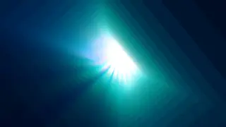
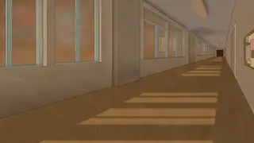
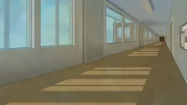
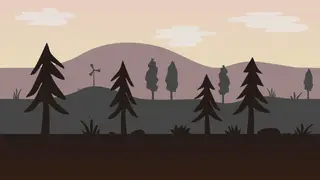

# RiceWM backgrounds

Public-domain wallpapers for **RiceWM.org**, used by Quick Wallpapers and the
Rice Marketplace. Originals and previews are hosted here as normalized WebP.

This repository contains 56 wallpapers: 24 creator-owned CC0 neon, abstract,
space, manga, anime-inspired and handpainted designs, alongside 32 individually
sourced landscapes and Japanese prints from The Metropolitan Museum of Art. Each item includes its
creator, source record, CC0 evidence and conversion hashes in
[catalog/candidates.json](catalog/candidates.json). Browse the previews below.

**Repository membership does not mean app approval.** The operator reviews
each exact image revision and its rights evidence before it appears in the app.
An image update requires a new review. Withdrawal takes it out of the app catalog.

## Contribute

Submit a pull request following [CONTRIBUTING.md](CONTRIBUTING.md). Only genuine
public-domain works or authorized CC0 dedications are accepted. A freely
downloadable image is not necessarily public domain. Do not submit images scraped
from wallpaper sites, proprietary game/anime art, or an unknown creator.

The private vetting process decodes sources in a restricted container, strips
metadata, checks dimensions and produces a full WebP plus 320×180 and 640×360
previews. Operators inspect the resulting images and source evidence. PRs never
receive publication credentials or authority to approve themselves.

## Copyright concerns

[Report a wallpaper privately to RiceWM.org](https://account.env.now/wallpaper-copyright).
Do not post your address, telephone number or confidential evidence in a public
issue. See [COPYRIGHT.md](COPYRIGHT.md) for notices, counter notifications,
withdrawals and repeat infringement.

Images carry their individual public-domain/CC0 evidence. RiceWM.org dedicates
any rights it owns in normalized derivatives and collection metadata under
[CC0 1.0](https://creativecommons.org/publicdomain/zero/1.0/). This dedication
cannot waive someone else's rights.

## Modern ricing collection

These 24 additions have creator CC0 evidence. Repository assets are independent of operator approval for app inclusion.

### Prismatic Bloom

Wenrexa · [creator source / CC0 evidence](https://wenrexa.itch.io/abstractbq)

### Neon Fold

Wenrexa · [creator source / CC0 evidence](https://wenrexa.itch.io/abstractbq)

### Midnight Prism

Wenrexa · [creator source / CC0 evidence](https://wenrexa.itch.io/abstractbq)

### Northern Glow

Wenrexa · [creator source / CC0 evidence](https://wenrexa.itch.io/abstractbq)

### Lime Vortex

Wenrexa · [creator source / CC0 evidence](https://wenrexa.itch.io/abstractbq)

### Chromatic Portal

Wenrexa · [creator source / CC0 evidence](https://wenrexa.itch.io/abstractbq)

### Teal Geometry

Wenrexa · [creator source / CC0 evidence](https://wenrexa.itch.io/abstractbq)

### Midnight Windows

Wenrexa · [creator source / CC0 evidence](https://wenrexa.itch.io/abstractbq)

### Aqua Fan

Wenrexa · [creator source / CC0 evidence](https://wenrexa.itch.io/abstractbq)

### Spectral Spiral

Wenrexa · [creator source / CC0 evidence](https://wenrexa.itch.io/abstractbq)

### Blue Flame

Wenrexa · [creator source / CC0 evidence](https://wenrexa.itch.io/abstractbq)

### Coral Current

Wenrexa · [creator source / CC0 evidence](https://wenrexa.itch.io/abstractbq)

### Electric Nebula

Wenrexa · [creator source / CC0 evidence](https://wenrexa.itch.io/spacebq2)

### Indigo Galaxy

Wenrexa · [creator source / CC0 evidence](https://wenrexa.itch.io/spacebq2)

### Blue Orbit

Wenrexa · [creator source / CC0 evidence](https://wenrexa.itch.io/spacebq2)

### Violet Dust

Wenrexa · [creator source / CC0 evidence](https://wenrexa.itch.io/spacebq2)

### Manga Megastructure

Pavel Kutejnikov · [creator source / CC0 evidence](https://opengameart.org/content/manga-style-background)

### Manga Skybridge

Pavel Kutejnikov · [creator source / CC0 evidence](https://opengameart.org/content/manga-style-background)

### School Hallway at Sunset

Iletora · [creator source / CC0 evidence](https://iletora.itch.io/school-hallway)

### School Hallway in Daylight

Iletora · [creator source / CC0 evidence](https://iletora.itch.io/school-hallway)

### Watercolour Woodland

Clifton Lambert · [creator source / CC0 evidence](https://prismshard77.itch.io/handpainted-visual-novel-backgrounds)

### Watercolour Meadow Path

Clifton Lambert · [creator source / CC0 evidence](https://prismshard77.itch.io/handpainted-visual-novel-backgrounds)

### Watercolour Open Meadow

Clifton Lambert · [creator source / CC0 evidence](https://prismshard77.itch.io/handpainted-visual-novel-backgrounds)

### Dusk Silhouettes

tigitalart · [creator source / CC0 evidence](https://opengameart.org/content/hills-scenery-background-seamless)

## Starter collection

### Canadian Rockies

Albert Bierstadt · [source](https://www.metmuseum.org/art/collection/search/10149) · [CC0 evidence](https://collectionapi.metmuseum.org/public/collection/v1/objects/10149)

### Merced River, Yosemite Valley

Albert Bierstadt · [source](https://www.metmuseum.org/art/collection/search/10150) · [CC0 evidence](https://collectionapi.metmuseum.org/public/collection/v1/objects/10150)

### Mountain Scene

Albert Bierstadt · [source](https://www.metmuseum.org/art/collection/search/10151) · [CC0 evidence](https://collectionapi.metmuseum.org/public/collection/v1/objects/10151)

### The Rocky Mountains, Lander's Peak

Albert Bierstadt · [source](https://www.metmuseum.org/art/collection/search/10154) · [CC0 evidence](https://collectionapi.metmuseum.org/public/collection/v1/objects/10154)

### Sea Cove

Albert Bierstadt · [source](https://www.metmuseum.org/art/collection/search/10155) · [CC0 evidence](https://collectionapi.metmuseum.org/public/collection/v1/objects/10155)

### The Aegean Sea

Frederic Edwin Church · [source](https://www.metmuseum.org/art/collection/search/10480) · [CC0 evidence](https://collectionapi.metmuseum.org/public/collection/v1/objects/10480)

### Heart of the Andes

Frederic Edwin Church · [source](https://www.metmuseum.org/art/collection/search/10481) · [CC0 evidence](https://collectionapi.metmuseum.org/public/collection/v1/objects/10481)

### The Parthenon

Frederic Edwin Church · [source](https://www.metmuseum.org/art/collection/search/10482) · [CC0 evidence](https://collectionapi.metmuseum.org/public/collection/v1/objects/10482)

### After the Storm

Albert Bierstadt · [source](https://www.metmuseum.org/art/collection/search/12849) · [CC0 evidence](https://collectionapi.metmuseum.org/public/collection/v1/objects/12849)

### Under the Wave off Kanagawa, also known as The Great Wave

Katsushika Hokusai · [source](https://www.metmuseum.org/art/collection/search/45434) · [CC0 evidence](https://collectionapi.metmuseum.org/public/collection/v1/objects/45434)

### Kintai Bridge in Suō Province

Katsushika Hokusai · [source](https://www.metmuseum.org/art/collection/search/36489) · [CC0 evidence](https://collectionapi.metmuseum.org/public/collection/v1/objects/36489)

### Cherry Blossoms at Arashiyama

Utagawa Hiroshige · [source](https://www.metmuseum.org/art/collection/search/36515) · [CC0 evidence](https://collectionapi.metmuseum.org/public/collection/v1/objects/36515)

### Sudden Shower at Shōno

Utagawa Hiroshige · [source](https://www.metmuseum.org/art/collection/search/36521) · [CC0 evidence](https://collectionapi.metmuseum.org/public/collection/v1/objects/36521)

### The Autumn Moon at Ishiyama on Lake Biwa

Utagawa Hiroshige · [source](https://www.metmuseum.org/art/collection/search/36527) · [CC0 evidence](https://collectionapi.metmuseum.org/public/collection/v1/objects/36527)

### Evening Snow on Hira, Lake Biwa

Utagawa Hiroshige · [source](https://www.metmuseum.org/art/collection/search/36533) · [CC0 evidence](https://collectionapi.metmuseum.org/public/collection/v1/objects/36533)

### Wheat Field with Cypresses

Vincent van Gogh · [source](https://www.metmuseum.org/art/collection/search/436535) · [CC0 evidence](https://collectionapi.metmuseum.org/public/collection/v1/objects/436535)

### Olive Trees

Vincent van Gogh · [source](https://www.metmuseum.org/art/collection/search/437998) · [CC0 evidence](https://collectionapi.metmuseum.org/public/collection/v1/objects/437998)

### Jalais Hill, Pontoise

Camille Pissarro · [source](https://www.metmuseum.org/art/collection/search/437299) · [CC0 evidence](https://collectionapi.metmuseum.org/public/collection/v1/objects/437299)

### A Cowherd at Valhermeil, Auvers-sur-Oise

Camille Pissarro · [source](https://www.metmuseum.org/art/collection/search/437300) · [CC0 evidence](https://collectionapi.metmuseum.org/public/collection/v1/objects/437300)

### The Boulevard Montmartre on a Winter Morning

Camille Pissarro · [source](https://www.metmuseum.org/art/collection/search/437310) · [CC0 evidence](https://collectionapi.metmuseum.org/public/collection/v1/objects/437310)

### View of the Seacoast near Wargemont in Normandy

Auguste Renoir · [source](https://www.metmuseum.org/art/collection/search/437426) · [CC0 evidence](https://collectionapi.metmuseum.org/public/collection/v1/objects/437426)

### The Bay of Naples

Auguste Renoir · [source](https://www.metmuseum.org/art/collection/search/437427) · [CC0 evidence](https://collectionapi.metmuseum.org/public/collection/v1/objects/437427)

### Hills around the Bay of Moulin Huet, Guernsey

Auguste Renoir · [source](https://www.metmuseum.org/art/collection/search/437431) · [CC0 evidence](https://collectionapi.metmuseum.org/public/collection/v1/objects/437431)

### The Bridge at Villeneuve-la-Garenne

Alfred Sisley · [source](https://www.metmuseum.org/art/collection/search/437680) · [CC0 evidence](https://collectionapi.metmuseum.org/public/collection/v1/objects/437680)

### Sahurs Meadows in Morning Sun

Alfred Sisley · [source](https://www.metmuseum.org/art/collection/search/437683) · [CC0 evidence](https://collectionapi.metmuseum.org/public/collection/v1/objects/437683)

### Venice, from the Porch of Madonna della Salute

Joseph Mallord William Turner · [source](https://www.metmuseum.org/art/collection/search/437853) · [CC0 evidence](https://collectionapi.metmuseum.org/public/collection/v1/objects/437853)

### Saltash with the Water Ferry, Cornwall

Joseph Mallord William Turner · [source](https://www.metmuseum.org/art/collection/search/437852) · [CC0 evidence](https://collectionapi.metmuseum.org/public/collection/v1/objects/437852)

### Whalers

Joseph Mallord William Turner · [source](https://www.metmuseum.org/art/collection/search/437854) · [CC0 evidence](https://collectionapi.metmuseum.org/public/collection/v1/objects/437854)

### The Road from Versailles to Louveciennes

Alfred Sisley · [source](https://www.metmuseum.org/art/collection/search/437685) · [CC0 evidence](https://collectionapi.metmuseum.org/public/collection/v1/objects/437685)

### View of Marly-le-Roi from Coeur-Volant

Alfred Sisley · [source](https://www.metmuseum.org/art/collection/search/437682) · [CC0 evidence](https://collectionapi.metmuseum.org/public/collection/v1/objects/437682)

### Barges at Pontoise

Camille Pissarro · [source](https://www.metmuseum.org/art/collection/search/437302) · [CC0 evidence](https://collectionapi.metmuseum.org/public/collection/v1/objects/437302)

### The Garden of the Tuileries on a Winter Afternoon

Camille Pissarro · [source](https://www.metmuseum.org/art/collection/search/437312) · [CC0 evidence](https://collectionapi.metmuseum.org/public/collection/v1/objects/437312)

## Wallpaper tags

Every candidate and conversion receipt stores descriptive `tags`. Quick Wallpapers and the marketplace provide a tag filter. New submissions require 1–12 distinct lowercase tags of up to 32 characters each. Tag changes are bound to the reviewed manifest.

- **School Hallway at Sunset**: `anime`, `anime-inspired`, `architecture`, `modern`, `warm`
- **School Hallway in Daylight**: `anime`, `anime-inspired`, `architecture`, `blue`, `modern`
- **Manga Megastructure**: `architecture`, `industrial`, `manga`, `modern`, `monochrome`
- **Manga Skybridge**: `architecture`, `industrial`, `manga`, `modern`, `monochrome`
- **Watercolour Woodland**: `forest`, `green`, `landscape`, `watercolour`
- **Watercolour Meadow Path**: `green`, `landscape`, `watercolour`
- **Watercolour Open Meadow**: `landscape`, `pastel`, `watercolour`
- **Dusk Silhouettes**: `landscape`, `minimal`, `modern`, `pastel`
- **Prismatic Bloom**: `abstract`, `colourful`, `modern`, `neon`
- **Neon Fold**: `abstract`, `geometric`, `modern`, `neon`
- **Midnight Prism**: `dark`, `geometric`, `minimal`, `modern`
- **Northern Glow**: `aurora`, `dark`, `minimal`, `modern`
- **Lime Vortex**: `abstract`, `green`, `modern`, `neon`
- **Chromatic Portal**: `abstract`, `colourful`, `modern`, `neon`
- **Teal Geometry**: `dark`, `geometric`, `modern`, `teal`
- **Midnight Windows**: `dark`, `geometric`, `modern`
- **Aqua Fan**: `abstract`, `minimal`, `modern`, `teal`
- **Spectral Spiral**: `abstract`, `colourful`, `modern`, `neon`
- **Blue Flame**: `blue`, `dark`, `minimal`, `modern`
- **Coral Current**: `abstract`, `coral`, `modern`, `pastel`
- **Electric Nebula**: `modern`, `nebula`, `neon`, `space`
- **Indigo Galaxy**: `blue`, `dark`, `modern`, `space`
- **Blue Orbit**: `blue`, `modern`, `planet`, `space`
- **Violet Dust**: `modern`, `nebula`, `purple`, `space`
- **Canadian Rockies**: `art`, `landscape`, `painting`
- **Merced River, Yosemite Valley**: `art`, `landscape`, `painting`
- **Mountain Scene**: `art`, `landscape`, `painting`
- **The Rocky Mountains, Lander's Peak**: `art`, `landscape`, `painting`
- **Sea Cove**: `art`, `landscape`, `painting`
- **The Aegean Sea**: `art`, `landscape`, `painting`
- **Heart of the Andes**: `art`, `landscape`, `painting`
- **The Parthenon**: `art`, `landscape`, `painting`
- **After the Storm**: `art`, `landscape`, `painting`
- **Kintai Bridge in Suō Province**: `art`, `japanese`, `woodblock`
- **Cherry Blossoms at Arashiyama**: `art`, `japanese`, `woodblock`
- **Sudden Shower at Shōno**: `art`, `japanese`, `woodblock`
- **The Autumn Moon at Ishiyama on Lake Biwa**: `art`, `japanese`, `woodblock`
- **Evening Snow on Hira, Lake Biwa**: `art`, `japanese`, `woodblock`
- **Wheat Field with Cypresses**: `art`, `landscape`, `painting`
- **Jalais Hill, Pontoise**: `art`, `landscape`, `painting`
- **A Cowherd at Valhermeil, Auvers-sur-Oise**: `art`, `landscape`, `painting`
- **Barges at Pontoise**: `art`, `landscape`, `painting`
- **The Boulevard Montmartre on a Winter Morning**: `art`, `landscape`, `painting`
- **The Garden of the Tuileries on a Winter Afternoon**: `art`, `landscape`, `painting`
- **View of the Seacoast near Wargemont in Normandy**: `art`, `landscape`, `painting`
- **The Bay of Naples**: `art`, `landscape`, `painting`
- **Hills around the Bay of Moulin Huet, Guernsey**: `art`, `landscape`, `painting`
- **The Bridge at Villeneuve-la-Garenne**: `art`, `landscape`, `painting`
- **View of Marly-le-Roi from Coeur-Volant**: `art`, `landscape`, `painting`
- **Sahurs Meadows in Morning Sun**: `art`, `landscape`, `painting`
- **The Road from Versailles to Louveciennes**: `art`, `landscape`, `painting`
- **Saltash with the Water Ferry, Cornwall**: `art`, `landscape`, `painting`
- **Venice, from the Porch of Madonna della Salute**: `art`, `landscape`, `painting`
- **Whalers**: `art`, `landscape`, `painting`
- **Olive Trees**: `art`, `landscape`, `painting`
- **Under the Wave off Kanagawa, also known as The Great Wave**: `art`, `japanese`, `woodblock`
