# RiceWM backgrounds

Public-domain wallpapers for **RiceWM.org**, used by Quick Wallpapers and the
Rice Marketplace. Originals and previews are hosted here as normalized WebP.

This repository starts with 32 individually sourced open-access landscapes and
Japanese prints from The Metropolitan Museum of Art. Each item includes its
creator, source record, CC0 evidence and conversion hashes in
[catalog/candidates.json](catalog/candidates.json). Browse the previews below.

**Repository membership does not mean app approval.** The operator reviews
each exact image revision and its rights evidence before it appears in the app.
An image update requires a new review. Withdrawal takes it out of the app catalog.

## Contribute

Submit a pull request following [CONTRIBUTING.md](CONTRIBUTING.md). Only genuine
public-domain works or authorized CC0 dedications are accepted. A freely
downloadable image is not necessarily public domain. Do not submit images scraped
from wallpaper sites, proprietary game/anime art, or an unknown creator.

The private vetting process decodes sources in a restricted container, strips
metadata, checks dimensions and produces a full WebP plus 320×180 and 640×360
previews. Operators inspect the resulting images and source evidence. PRs never
receive publication credentials or authority to approve themselves.

## Copyright concerns

[Report a wallpaper privately to RiceWM.org](https://account.env.now/wallpaper-copyright).
Do not post your address, telephone number or confidential evidence in a public
issue. See [COPYRIGHT.md](COPYRIGHT.md) for notices, counter notifications,
withdrawals and repeat infringement.

Images carry their individual public-domain/CC0 evidence. RiceWM.org dedicates
any rights it owns in normalized derivatives and collection metadata under
[CC0 1.0](https://creativecommons.org/publicdomain/zero/1.0/). This dedication
cannot waive someone else's rights.

## Starter collection

### Canadian Rockies

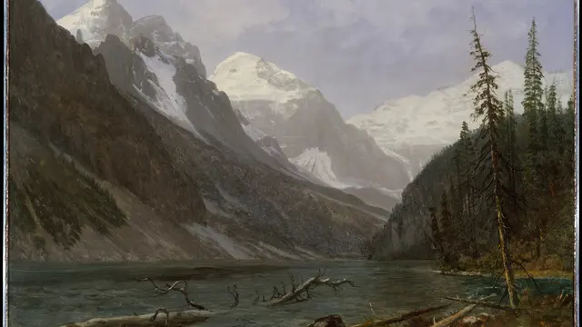

Albert Bierstadt · [source](https://www.metmuseum.org/art/collection/search/10149) · [CC0 evidence](https://collectionapi.metmuseum.org/public/collection/v1/objects/10149)

### Merced River, Yosemite Valley

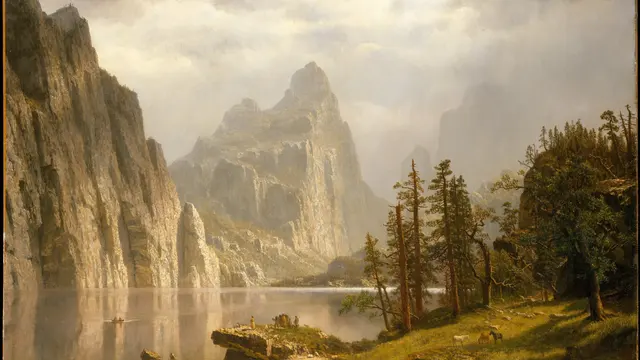

Albert Bierstadt · [source](https://www.metmuseum.org/art/collection/search/10150) · [CC0 evidence](https://collectionapi.metmuseum.org/public/collection/v1/objects/10150)

### Mountain Scene

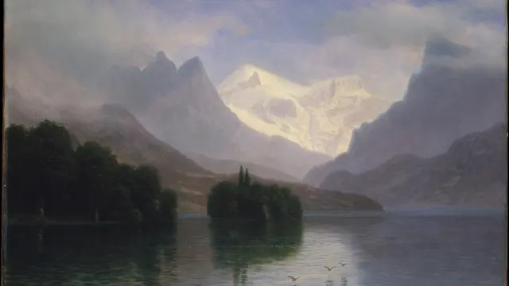

Albert Bierstadt · [source](https://www.metmuseum.org/art/collection/search/10151) · [CC0 evidence](https://collectionapi.metmuseum.org/public/collection/v1/objects/10151)

### The Rocky Mountains, Lander's Peak

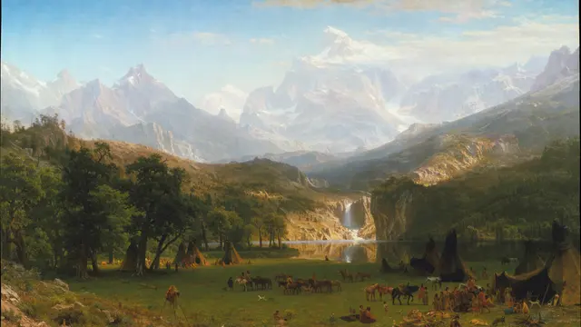

Albert Bierstadt · [source](https://www.metmuseum.org/art/collection/search/10154) · [CC0 evidence](https://collectionapi.metmuseum.org/public/collection/v1/objects/10154)

### Sea Cove

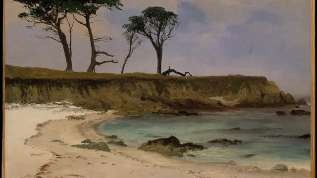

Albert Bierstadt · [source](https://www.metmuseum.org/art/collection/search/10155) · [CC0 evidence](https://collectionapi.metmuseum.org/public/collection/v1/objects/10155)

### The Aegean Sea

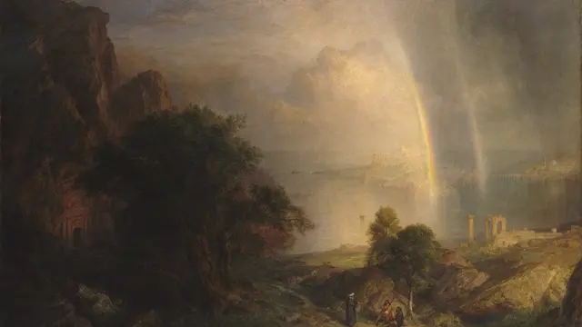

Frederic Edwin Church · [source](https://www.metmuseum.org/art/collection/search/10480) · [CC0 evidence](https://collectionapi.metmuseum.org/public/collection/v1/objects/10480)

### Heart of the Andes

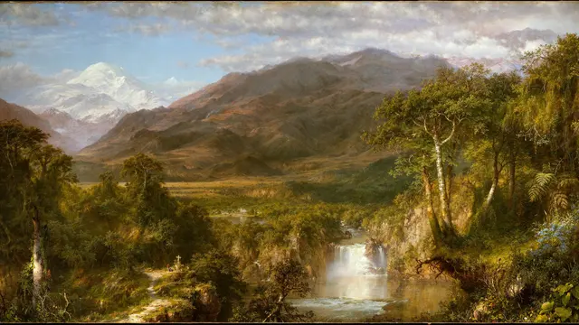

Frederic Edwin Church · [source](https://www.metmuseum.org/art/collection/search/10481) · [CC0 evidence](https://collectionapi.metmuseum.org/public/collection/v1/objects/10481)

### The Parthenon

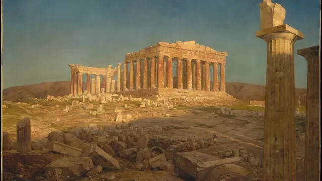

Frederic Edwin Church · [source](https://www.metmuseum.org/art/collection/search/10482) · [CC0 evidence](https://collectionapi.metmuseum.org/public/collection/v1/objects/10482)

### After the Storm

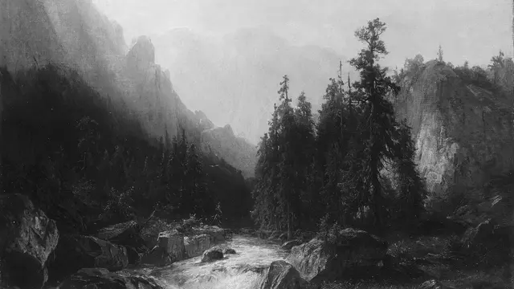

Albert Bierstadt · [source](https://www.metmuseum.org/art/collection/search/12849) · [CC0 evidence](https://collectionapi.metmuseum.org/public/collection/v1/objects/12849)

### Under the Wave off Kanagawa, also known as The Great Wave

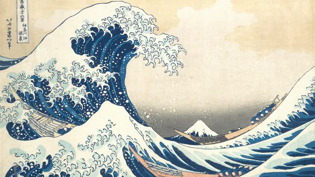

Katsushika Hokusai · [source](https://www.metmuseum.org/art/collection/search/45434) · [CC0 evidence](https://collectionapi.metmuseum.org/public/collection/v1/objects/45434)

### Kintai Bridge in Suō Province

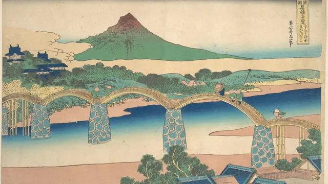

Katsushika Hokusai · [source](https://www.metmuseum.org/art/collection/search/36489) · [CC0 evidence](https://collectionapi.metmuseum.org/public/collection/v1/objects/36489)

### Cherry Blossoms at Arashiyama

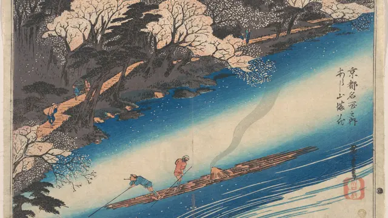

Utagawa Hiroshige · [source](https://www.metmuseum.org/art/collection/search/36515) · [CC0 evidence](https://collectionapi.metmuseum.org/public/collection/v1/objects/36515)

### Sudden Shower at Shōno

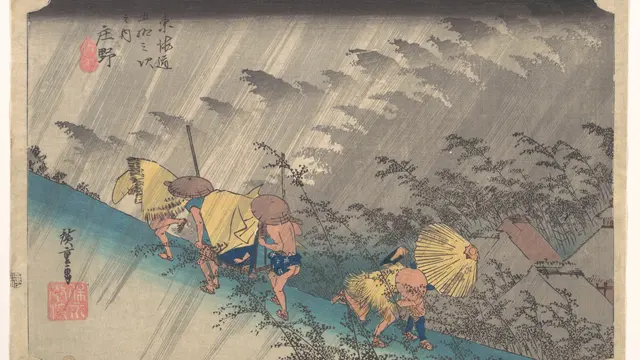

Utagawa Hiroshige · [source](https://www.metmuseum.org/art/collection/search/36521) · [CC0 evidence](https://collectionapi.metmuseum.org/public/collection/v1/objects/36521)

### The Autumn Moon at Ishiyama on Lake Biwa

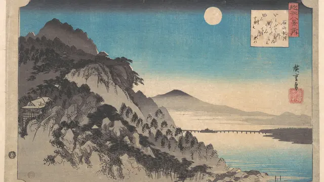

Utagawa Hiroshige · [source](https://www.metmuseum.org/art/collection/search/36527) · [CC0 evidence](https://collectionapi.metmuseum.org/public/collection/v1/objects/36527)

### Evening Snow on Hira, Lake Biwa

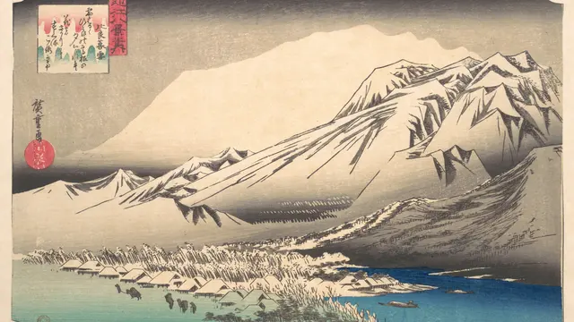

Utagawa Hiroshige · [source](https://www.metmuseum.org/art/collection/search/36533) · [CC0 evidence](https://collectionapi.metmuseum.org/public/collection/v1/objects/36533)

### Wheat Field with Cypresses

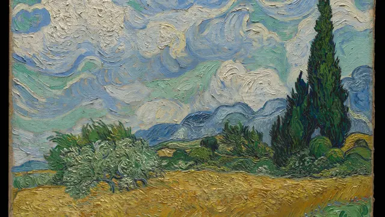

Vincent van Gogh · [source](https://www.metmuseum.org/art/collection/search/436535) · [CC0 evidence](https://collectionapi.metmuseum.org/public/collection/v1/objects/436535)

### Olive Trees

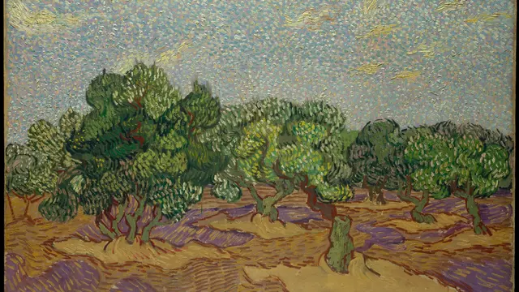

Vincent van Gogh · [source](https://www.metmuseum.org/art/collection/search/437998) · [CC0 evidence](https://collectionapi.metmuseum.org/public/collection/v1/objects/437998)

### Jalais Hill, Pontoise

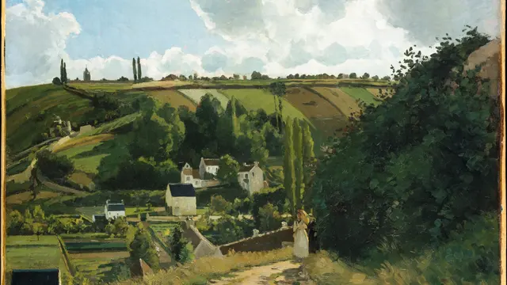

Camille Pissarro · [source](https://www.metmuseum.org/art/collection/search/437299) · [CC0 evidence](https://collectionapi.metmuseum.org/public/collection/v1/objects/437299)

### A Cowherd at Valhermeil, Auvers-sur-Oise

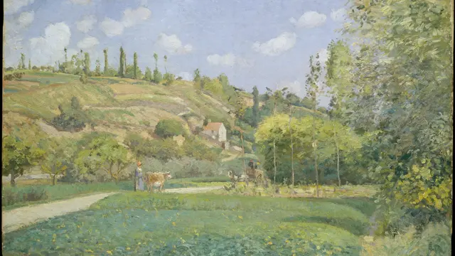

Camille Pissarro · [source](https://www.metmuseum.org/art/collection/search/437300) · [CC0 evidence](https://collectionapi.metmuseum.org/public/collection/v1/objects/437300)

### The Boulevard Montmartre on a Winter Morning

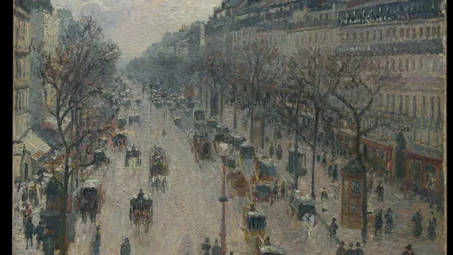

Camille Pissarro · [source](https://www.metmuseum.org/art/collection/search/437310) · [CC0 evidence](https://collectionapi.metmuseum.org/public/collection/v1/objects/437310)

### View of the Seacoast near Wargemont in Normandy

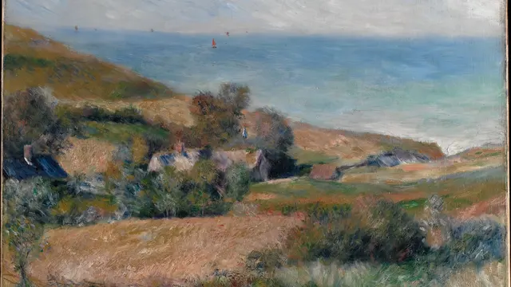

Auguste Renoir · [source](https://www.metmuseum.org/art/collection/search/437426) · [CC0 evidence](https://collectionapi.metmuseum.org/public/collection/v1/objects/437426)

### The Bay of Naples

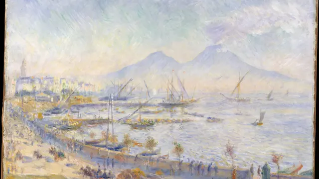

Auguste Renoir · [source](https://www.metmuseum.org/art/collection/search/437427) · [CC0 evidence](https://collectionapi.metmuseum.org/public/collection/v1/objects/437427)

### Hills around the Bay of Moulin Huet, Guernsey

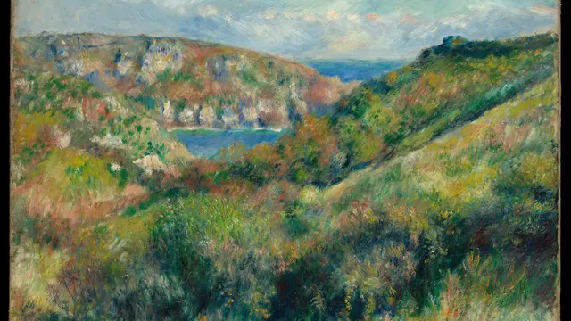

Auguste Renoir · [source](https://www.metmuseum.org/art/collection/search/437431) · [CC0 evidence](https://collectionapi.metmuseum.org/public/collection/v1/objects/437431)

### The Bridge at Villeneuve-la-Garenne

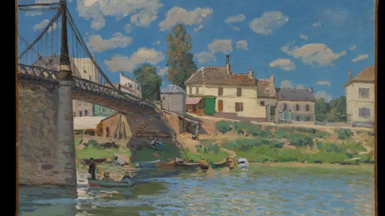

Alfred Sisley · [source](https://www.metmuseum.org/art/collection/search/437680) · [CC0 evidence](https://collectionapi.metmuseum.org/public/collection/v1/objects/437680)

### Sahurs Meadows in Morning Sun

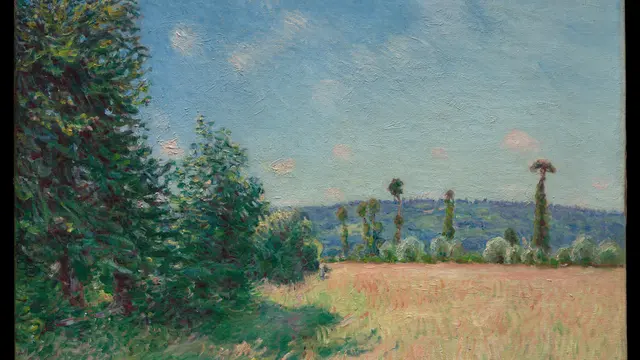

Alfred Sisley · [source](https://www.metmuseum.org/art/collection/search/437683) · [CC0 evidence](https://collectionapi.metmuseum.org/public/collection/v1/objects/437683)

### Venice, from the Porch of Madonna della Salute

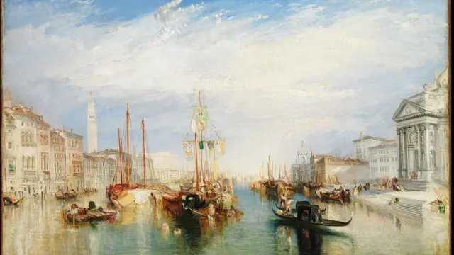

Joseph Mallord William Turner · [source](https://www.metmuseum.org/art/collection/search/437853) · [CC0 evidence](https://collectionapi.metmuseum.org/public/collection/v1/objects/437853)

### Saltash with the Water Ferry, Cornwall

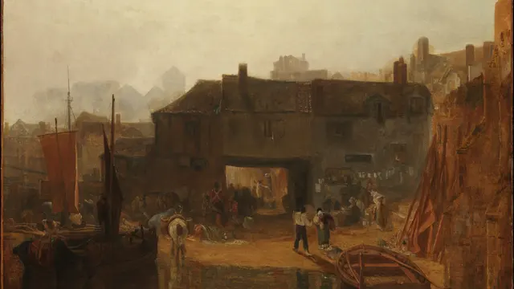

Joseph Mallord William Turner · [source](https://www.metmuseum.org/art/collection/search/437852) · [CC0 evidence](https://collectionapi.metmuseum.org/public/collection/v1/objects/437852)

### Whalers

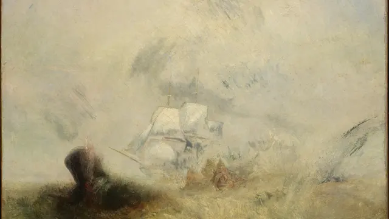

Joseph Mallord William Turner · [source](https://www.metmuseum.org/art/collection/search/437854) · [CC0 evidence](https://collectionapi.metmuseum.org/public/collection/v1/objects/437854)

### The Road from Versailles to Louveciennes

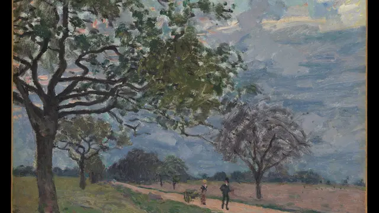

Alfred Sisley · [source](https://www.metmuseum.org/art/collection/search/437685) · [CC0 evidence](https://collectionapi.metmuseum.org/public/collection/v1/objects/437685)

### View of Marly-le-Roi from Coeur-Volant

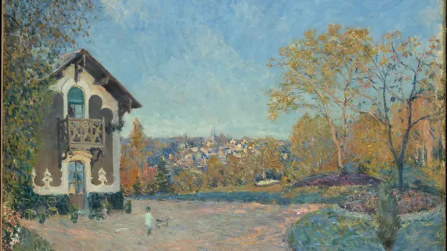

Alfred Sisley · [source](https://www.metmuseum.org/art/collection/search/437682) · [CC0 evidence](https://collectionapi.metmuseum.org/public/collection/v1/objects/437682)

### Barges at Pontoise

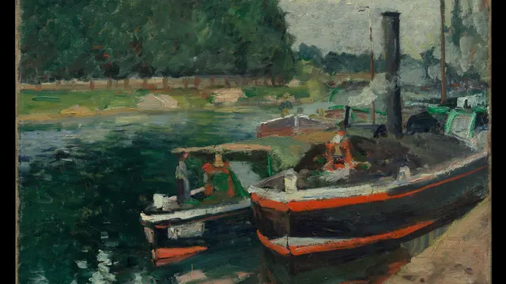

Camille Pissarro · [source](https://www.metmuseum.org/art/collection/search/437302) · [CC0 evidence](https://collectionapi.metmuseum.org/public/collection/v1/objects/437302)

### The Garden of the Tuileries on a Winter Afternoon

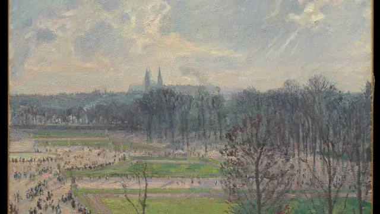

Camille Pissarro · [source](https://www.metmuseum.org/art/collection/search/437312) · [CC0 evidence](https://collectionapi.metmuseum.org/public/collection/v1/objects/437312)
